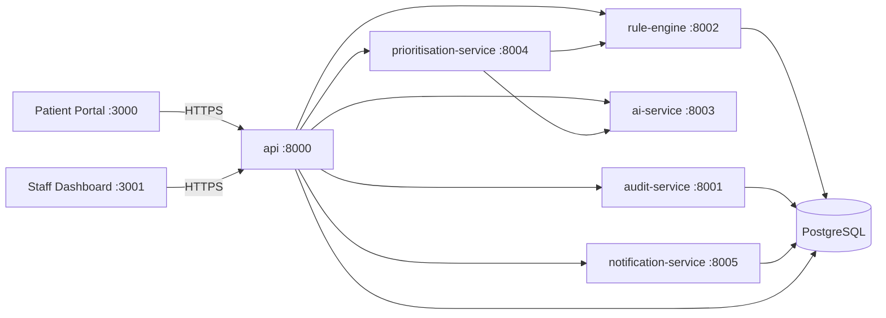

# CarePrior

**AI-assisted intake. Human-led decisions.**

> **32040 Industry Project** — Spring 2026 — University of Technology Sydney — Master of Information Technology
> Project title: *Design and Evaluation of an Explainable, Human-Supervised AI Clinical Intake and Prioritisation Platform for Primary Healthcare*

> ⚠️ **This software is an academic research prototype.** It is not a medical device and has not been clinically
> validated. It must not be used to diagnose, treat, prevent or manage any medical condition, and must not be
> relied upon for real patient triage or emergency decision-making. All outputs require review by appropriately
> qualified healthcare professionals. **All data used is synthetic and fictional.** In a real emergency in Australia, call **Triple Zero (000)**.

---

## 1. Overview

CarePrior is a human-supervised, hybrid AI + deterministic-rule clinical intake and prioritisation prototype for
primary-care appointment requests. It investigates whether adaptive questioning, explainable AI, deterministic
safety rules, and mandatory human review can produce more consistent prioritisation than a static intake form —
without ever diagnosing, prescribing, or acting autonomously.

See [docs/project-management/phase-1-discovery.md](docs/project-management/phase-1-discovery.md) for the full
architecture rationale, assumptions, and scope decisions behind this build.

**Start here for the full picture:** [docs/PROJECT-OVERVIEW.md](docs/PROJECT-OVERVIEW.md) is the single entry
point into every other document below.

| Document | Covers |
|---|---|
| [docs/PROJECT-OVERVIEW.md](docs/PROJECT-OVERVIEW.md) | Full rundown — problem, innovation, stack, AI logic, roles, plan, live-demo instructions |
| [docs/research/literature-review.md](docs/research/literature-review.md) | Existing booking/triage systems, the literature gap this project targets |
| [docs/architecture/tech-stack.md](docs/architecture/tech-stack.md) | Every technology choice and why |
| [docs/architecture/ai-logic.md](docs/architecture/ai-logic.md) | The core methodology: AI, rule engine, precedence model, adaptive Q&A |
| [docs/project-management/milestone-planner.md](docs/project-management/milestone-planner.md) | 12-week schedule, 27 Jul–18 Oct, milestones and buffer |
| [docs/project-management/role-perspectives.md](docs/project-management/role-perspectives.md) | The system from every user role's point of view |
| [docs/project-management/phase-1-discovery.md](docs/project-management/phase-1-discovery.md) | Original architecture decisions, assumptions, risk register |

## 2. Problem statement

Practices and telehealth providers receive appointment requests with vague, incomplete, or inconsistent
descriptions, reviewed by staff who may have limited clinical training and little time. Static forms collect the
same fields from everyone regardless of situation. CarePrior asks whether a hybrid system — deterministic safety
rules that can never be overridden by AI, combined with AI-assisted interpretation and adaptive follow-up
questions — can flag requests needing earlier human attention more consistently, while remaining fully explainable
and auditable.

## 3. What's implemented in this build

This is a **full vertical slice**: the complete brief case-study scenario (vague symptom description → adaptive
follow-up questions → chest-pain/sweating/arm-radiation disclosure → deterministic immediate-review rule trigger →
staff review with explanation → accept/override → append-only audit trail) works end-to-end through every
architectural service.

- **6 backend services**, each an independent FastAPI deployable unit: `api` (auth/RBAC + orchestration),
  `ai-service` (mock AI provider), `rule-engine` (deterministic prototype rules), `prioritisation-service`
  (combination + precedence), `audit-service` (append-only log), `notification-service` (in-app staff alerts).
- **3 frontend apps**: `patient-portal` (Next.js) and `staff-dashboard` (Next.js), styled to the CarePrior brand
  tokens (Deep Teal palette, Inter typeface, status chips that never rely on colour alone); plus
  `hospital-website` (Next.js), a public-facing marketing site for the fictional "Hamilton's Hospital"
  that links into the patient portal to start a request.
- **Single shared PostgreSQL instance**, schema-per-service (`api`, `rules`, `audit`, `notification`), so each
  service owns its own tables without a shared database class.
- **Full RBAC** across 6 seeded demo accounts (patient, reception, nurse, manager, admin, researcher).
- **Deterministic rule engine** with 8 prototype rules (AND/OR/nested conditions, severity, precedence),
  including the exact cardiac warning cluster from the brief's case study.
- **Mock AI provider** behind a swappable `AIProvider` interface — deterministic, free, reproducible; a real
  Anthropic/OpenAI adapter can be added later without touching domain logic.
- **Prioritisation precedence**: deterministic rule outcomes can never be downgraded by AI; AI failure or low
  confidence routes to *Manual Review Required*, never silently to *Routine Review*.
- **Append-only audit log**, staff review queue, accept/override (mandatory reason)/escalate/request-information
  workflow, and an audit explorer screen.

### Deferred beyond this build (see §7)

`research-console` (4th app / research-evaluation mode comparison), the full 46-screen and 40–60 FR breadth, the
30-scenario synthetic library, Redis/queues, Alembic migrations (currently `create_all` on startup), and granular
Role/Permission/UserRole tables (currently a single `role` column on `User`) are documented, deliberate scope
reductions for this build pass — not oversights. See the discovery doc for the full rationale.

## 4. Architecture



`prioritisation-service` is stateless — it calls `rule-engine` and `ai-service` itself and returns a combined
recommendation, which `api` persists against the appointment request.

## 5. Running locally

### Prerequisites

- **Docker Desktop** (or compatible Docker Engine + Compose v2) — this build was developed and logic-tested in a
  sandbox without Docker available, so **you must run `docker compose up` yourself on a machine with Docker
  installed** to see it live. Every service was individually validated (see §6) but the full container network
  has not yet been exercised end-to-end by a live `docker compose up` run.

### Steps

```bash
git clone <this repo>
cd 32040_ZihadBurhan_14334116
cp .env.example .env        # defaults work for local dev — replace JWT_SECRET for anything beyond localhost
docker compose up --build
```

This starts Postgres and all 6 backend services, then the frontends:

| App | URL |
|---|---|
| Patient portal | http://localhost:3000 |
| Staff dashboard | http://localhost:3001 |
| Hospital website (public marketing site) | http://localhost:3002 |
| API (Swagger docs) | http://localhost:8000/docs |

First boot takes longer (image builds + `npm install` inside containers). Subsequent `docker compose up` runs are
fast. Each service creates its own Postgres schema and tables on startup — no manual migration step needed for
this prototype.

### Demo accounts (password for all: `CarePriorDev!23`)

| Role | Email |
|---|---|
| Patient | patient@careprior.local |
| Reception | reception@careprior.local |
| Nurse / Clinical Reviewer | clinician@careprior.local |
| Practice Manager | manager@careprior.local |
| System Administrator | admin@careprior.local |
| Research Evaluator | researcher@careprior.local |

Replace this password before any use beyond local development.

### Demo script (the brief's case study)

1. Log in to the patient portal as `patient@careprior.local`, grant consent.
2. Create a request: category "Respiratory", description *"I have been feeling tired and slightly short of
   breath."*
3. Answer the adaptive follow-up questions — when asked, report **chest discomfort = yes**, **sweating = yes**,
   **arm radiation = yes**.
4. Submit. The recommendation (hidden internals) will show a request for immediate staff attention.
5. Log in to the staff dashboard as `clinician@careprior.local` — the request appears at the top of the queue as
   **Immediate Human Review**, with the triggered rule, matched answers, and reasoning visible.
6. Accept or override (override requires a reason) — then open **Audit explorer** to see the full append-only
   trail: submission → AI interpretation → rule trigger → prioritisation → staff decision.

### AI provider

`AI_PROVIDER=mock` by default (`.env.example`) — deterministic, no external calls, no cost. The `AIProvider`
interface (`services/ai-service/app/providers/base.py`) allows a real Anthropic/OpenAI-compatible adapter to be
added later without any change to domain logic in `prioritisation-service` or `api`.

## 6. What has actually been tested (and how, given no Docker in the build environment)

This build was produced in a sandboxed environment **without Docker, Node, or a modern Python available
system-wide**. Rather than skip verification, the following was done using portable, non-system-installed
toolchains and removed afterwards:

- **Both Next.js apps** (`patient-portal`, `staff-dashboard`) were `npm install`ed and `next build`ed against a
  portable Node 20 — both compile with **zero TypeScript errors** across all 13 routes.
- **All 6 backend services** were import-checked under a portable Python 3.12 with the exact pinned
  dependencies from each `requirements.txt` — all import cleanly (this caught and fixed a missing
  `email-validator` dependency required by `EmailStr` in `api`, and a Pydantic protected-namespace warning).
- **Every SQLAlchemy model** across the 4 database-backed services was compiled to real PostgreSQL DDL
  (`CREATE TABLE …`) without a live database — confirms schemas, foreign keys, and JSON/UUID column types are
  valid before you ever run `docker compose up`.
- **The rule engine** was unit-tested directly: the case-study facts correctly trigger `RULE-CARDIAC-001` and
  `RULE-SEVERE-WORSENING-001`; a routine low-risk case triggers nothing; the insufficient-information and
  fainting rules fire independently.
- **The mock AI provider** was unit-tested: correct symptom/severity extraction from free text, correct
  incorporation of structured follow-up answers into risk indicators, and correct contradiction detection.
- **The full prioritisation pipeline** was unit-tested with the network calls mocked: the case study resolves to
  `Immediate Human Review`; a low-confidence/uncertain AI signal cannot downgrade a higher deterministic rule
  outcome; an AI-service outage correctly routes to `Manual Review Required` rather than failing silently.
- **Password hashing and JWT issuing/verification** were exercised directly and behave correctly.

**Not yet tested**: an actual live `docker compose up` with real inter-container networking and a real Postgres
instance, and the browser UI itself. Please run the demo script above and report anything that doesn't work —
the logic underneath it has been verified, but container networking/env-var wiring is the one layer that could
not be exercised in this environment.

## 7. Known limitations / deliberate scope reductions

- No `research-console` app or 4-mode (Static/Rule-only/AI-only/Hybrid) evaluation harness yet — Phase 10 item.
- `create_all()` on startup instead of Alembic migrations — fine for a prototype with no existing data to
  migrate; documented hardening-phase item.
- Single `role` column on `User` instead of full `Role`/`Permission`/`UserRole` tables.
- 8 prototype rules and a 9-question adaptive library, not the full 40–60 FR / 30-scenario breadth from the
  brief — this build is one complete vertical slice, deepened and widened in later phases.
- No server-side JWT revocation/blacklisting (logout is client-side token discard only).
- Adaptive questioning always asks its fixed question set; it does not yet skip questions the AI has already
  inferred from free text with high confidence (a genuine future improvement, not a bug — deterministic rule
  inputs intentionally come only from explicit structured patient answers, never from AI inference).

## 8. Repository structure

See [docs/project-management/phase-1-discovery.md](docs/project-management/phase-1-discovery.md) for the full
target structure and the rationale for the `services/shared` addition.

## 9. Research questions this platform is designed to support

1. Can a hybrid AI + deterministic system identify requests needing earlier review more effectively than a
   static form?
2. Does adaptive questioning improve prioritisation over a static form?
3. Do explanations improve staff understanding of AI-generated recommendations?
4. How should the system respond to incomplete, ambiguous, or contradictory information?
5. How can automation bias / staff overreliance be reduced?
6. How does hybrid compare with static-form / rule-only / AI-only modes?
7. What privacy, security, governance and audit controls does a system like this need?

## 10. Disclaimer

This software is an academic research prototype. It is not a medical device and has not been clinically
validated. It must not be used to diagnose, treat, prevent or manage any medical condition. It must not be relied
upon for real patient triage or emergency decision-making. All outputs require review by appropriately qualified
healthcare professionals. All patient data in this repository is synthetic.
