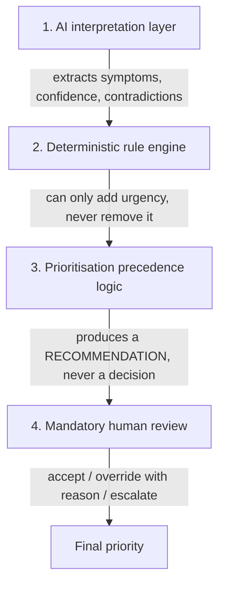

# AI & Decision Logic — CarePrior

**Subject:** 32040 Industry Project | UTS Master of IT | Spring 2026
**Purpose:** This is the document that matters most for grading on methodology. It explains *exactly* what the "AI" in CarePrior does, what it does not do, how it combines with deterministic rules, and why the combination is designed the way it is. Every claim below is traceable to a specific file in `services/`.

---

## 1. The core design principle: AI proposes, rules dispose, humans decide

CarePrior is **not** an AI diagnostic tool. It is a prioritisation-support system with three layers, evaluated in this strict order of authority:



1. **AI interpretation** (lowest authority) — reads free text, proposes structured facts and a confidence score. Can suggest, can be wrong, can be low-confidence, can fail outright.
2. **Deterministic rules** (highest authority) — evaluate patient-*confirmed* structured answers against fixed, versioned, human-authored IF/AND/OR conditions. If a rule fires, its category is a floor that AI can never lower.
3. **Precedence combination** — a small, directly-testable function (`prioritisation-service/app/pipeline.py`) that merges (1) and (2) under the floor rule in (3).
4. **Human review** — every single recommendation, regardless of category, requires a staff member to accept or override (with a mandatory typed reason) before it becomes final. The system never auto-acts.

This ordering is the direct answer to a well-documented failure mode in clinical AI: over-trusting a single opaque model (see [literature-review.md](../research/literature-review.md) §3–4 on symptom-checker safety incidents and automation bias). By construction, CarePrior cannot silently downgrade urgency because an LLM was uncertain, and it cannot skip a human because a rule was confident.

---

## 2. Layer 1 — AI interpretation (`services/ai-service`)

### 2.1 Interface, not implementation

`app/providers/base.py` defines an abstract `AIProvider` with one method:

```python
interpret(free_text: str, structured_answers: dict) -> AIInterpretationOutput
```

`app/providers/factory.py` selects an implementation from the `AI_PROVIDER` env var (`mock` today; the interface is written so a real Anthropic Claude adapter can be dropped in later — same method signature, same output schema — with **zero changes** to `prioritisation-service` or `api`). This matters academically: the prioritisation logic and precedence model are provider-agnostic by construction, not by accident, so a future "swap in a real LLM" chapter of this project is an implementation detail, not a redesign.

### 2.2 What the mock provider actually does (`mock_provider.py`)

The mock provider is deliberately simple and fully deterministic — every run on the same input produces the same output, which is a **hard requirement**, not a shortcut: the planned research-evaluation module (comparing Static-form / Rule-only / AI-only / Hybrid modes) needs reproducible AI behaviour to make any comparison meaningful. A temperature-sampled LLM would make that evaluation unrepeatable.

It performs:
- **Keyword-based symptom extraction** against a curated dictionary (`SYMPTOM_KEYWORDS`) — e.g. "tight chest", "chest pressure", "chest discomfort" all map to the canonical symptom `chest discomfort`, which in turn maps to the risk-indicator key `chest_discomfort` that the rule engine understands.
- **Severity/onset/worsening inference** from free text (`SEVERITY_KEYWORDS`, `ONSET_KEYWORDS`, `WORSENING_KEYWORDS`) when not already given as a structured answer — structured answers always take precedence over free-text inference.
- **Duration parsing** via regex (`\d+\s*(hour|day|week)`).
- **Contradiction detection** — if the patient's free text implies one severity ("slightly") but a structured follow-up answer says another ("severe"), this is flagged explicitly, not silently resolved.
- **Confidence scoring** — starts at 0.9, degraded for short free text (<8 words with no structured answers → 0.45), for each missing core field (duration/severity/onset), and clamped to ≤0.5 if a contradiction was found.
- **Missing-information and follow-up-topic lists** — drives which adaptive questions get asked next (§3).

### 2.3 What it deliberately does *not* do

- It never outputs a diagnosis, a treatment suggestion, or a "you should/shouldn't see a doctor" statement.
- It never writes directly into the facts the rule engine evaluates — see §3.4 (the AI-suggestion / patient-confirmation boundary). This is the single most important safety property of the design: **rule-engine inputs are always explicit, patient-confirmed structured answers, never raw AI inference.**
- If it fails (timeout, service down), the caller (`prioritisation-service`) does not retry into a degraded state — it routes to `Manual Review Required` (§4.2), never to `Routine Review`. Silent failure into a low-urgency bucket is the one outcome the design treats as unacceptable.

---

## 3. Layer 1.5 — Adaptive questioning (`services/api/app/question_library.py`)

### 3.1 Why adaptive, not a static form

A static intake form asks every patient the same fixed fields regardless of relevance — the exact limitation identified in the booking-system literature (see [literature-review.md](../research/literature-review.md) §1, §5). CarePrior instead asks a **variable subset** of a fixed 9-question library, branching on prior answers, capped at `MAX_QUESTIONS = 9` so the flow can't run away.

### 3.2 The branching mechanism

Each question has an `applies_if(facts) -> bool` predicate evaluated against the facts collected so far:

- Core questions (`onset`, `severity`, `worsening`, `duration_hours`, `chest_discomfort`, `fainting`, `confusion`) use `_always` — asked of everyone (still gated by "not already answered / not already inferable"), because they feed the core deterministic rules.
- **Conditional questions** (`sweating`, `arm_radiation`) use `_if_chest_discomfort` — they are only ever asked if the patient has already indicated chest discomfort. This is the concrete, auditable example of "adaptive": a patient with no chest symptoms is never asked about arm radiation.

`next_applicable_question(facts, answered_keys)` walks the fixed-order library and returns the first unanswered, applicable question, or `None` when the library is exhausted or the cap is hit — the API layer (`requests.py::get_next_question`) calls this once per question-fetch, persists a `QuestionResponse` row recording the exact question text **and the reason it was asked** (`reason_for_asking`) at ask-time, so the audit trail shows not just what was asked but *why*, satisfying the explainability requirement end-to-end, not just at the final recommendation.

### 3.3 Why this specific cluster (chest discomfort → sweating/arm radiation)

This mirrors a real, widely taught clinical heuristic (chest discomfort with diaphoresis or radiating pain as a cardiac-warning cluster — see the ESI/Manchester Triage discussion in the literature review) chosen deliberately as the brief's worked case study, encoded here as both a question-branching rule (§3.2) and a rule-engine condition (§4.1, `RULE-CARDIAC-001`) — the same clinical logic appears at two layers for two different purposes: asking the right follow-up, and then acting on the answer.

### 3.4 The AI-suggestion boundary (a safety-critical design choice)

`suggested_value()` lets the UI **pre-fill** a suggested answer to a question if the AI's free-text read was confident enough (`SUGGESTION_CONFIDENCE_THRESHOLD = 0.75`) — e.g. if the patient already wrote "severe chest pain" in free text, the severity question can default to "severe" rather than making them retype it. But:

- This only ever changes what's *pre-selected* in the UI.
- The patient must still explicitly submit/confirm the answer through the normal `POST /responses` path.
- The rule engine **only ever reads confirmed `QuestionResponse` facts**, never `ai_preview` directly.

This is the deliberate line between "AI-assisted" (reduces friction, still gated by human confirmation) and "AI-autonomous" (writes clinical facts without a human in the loop) — the project takes the former and explicitly rejects the latter, which is the whole thesis of the "human-supervised" framing in the project title.

---

## 4. Layer 2 — Deterministic rule engine (`services/rule-engine`)

### 4.1 Rule structure

8 seeded prototype rules (`seed_rules.py`), each with: a stable `rule_key`, human-readable `name`/`description`, a `severity`, a `priority_category` (one of the 5 precedence buckets, §5.1), a nested boolean `conditions` tree (`AND`/`OR`/leaf `{field, op, value}`), and an `explanation_template` that gets filled with the matched field(s) at evaluation time — so every trigger is human-readable, not just a rule ID.

Representative rules:

| Rule | Logic | Category |
|---|---|---|
| `RULE-CARDIAC-001` | `chest_discomfort == True AND (sweating == True OR arm_radiation == True)` | Immediate Human Review |
| `RULE-FAINT-001` | `fainting == True` | Immediate Human Review |
| `RULE-CONFUSION-001` | `confusion == True` | Immediate Human Review |
| `RULE-SEVERE-WORSENING-001` | `severity == "severe" AND worsening == True` | Priority Review |
| `RULE-MODERATE-WORSENING-001` | `severity == "moderate" AND worsening == True` | Priority Review |
| `RULE-DURATION-EXTENDED-001` | `duration_hours >= 48 AND severity != "mild"` | Priority Review |
| `RULE-CONTRADICTION-001` | `contradiction_detected == True` | Manual Review Required |
| `RULE-MISSING-CORE-001` | `missing_duration AND missing_severity AND missing_onset` | Insufficient Information |

`evaluator.py` evaluates every rule against the submitted facts; **all** triggered rules are returned (not just the first match) so the recommendation can show the full reasoning, and the most severe category wins (§5.1's precedence order) if more than one fires.

### 4.2 Why deterministic rules exist at all, given there's an AI layer

Three reasons, all load-bearing:
1. **Explainability by construction** — a rule's `explanation_template` is a plain-English sentence with the matched fact substituted in; there is no "the model decided this" black box for the highest-stakes category.
2. **Auditable safety guarantee** — because rules are simple boolean trees over explicit patient-confirmed facts, their behaviour is fully enumerable and unit-testable (every rule has a corresponding test case verifying it fires/doesn't fire on known inputs).
3. **Precedence floor** — this is the core innovation claim of the project (§5): a rule category can never be downgraded by a lower-confidence or differently-opinioned AI read. This directly targets the "over-triage vs under-triage" trust problem identified in the AI symptom-checker literature.

---

## 5. Layer 3 — Precedence combination (`services/prioritisation-service/app/pipeline.py`)

### 5.1 The five-category precedence order

```
Immediate Human Review > Priority Review > Manual Review Required > Insufficient Information > Routine Review
```

(`PRECEDENCE_ORDER` in `careprior_shared/schemas.py` — the single source of truth both `rule-engine` output ranking and `prioritisation-service`'s combination logic import.)

### 5.2 The combination algorithm, in words

1. Call `rule-engine` with the submitted facts → get all triggered rules → take the **most severe** category among them (`rule_category`), or `None` if nothing triggered.
2. Call `ai-service` with the free text + facts:
   - If the call fails outright → `ai_category = "Manual Review Required"`, `uncertainty = high`. **This is the one hard-coded fail-safe in the whole pipeline**: an AI outage never silently resolves to "everything's fine."
   - Else, derive `ai_category` from confidence/contradictions/missing-information (contradiction → Manual Review Required; confidence < 0.55 → Manual Review Required; ≥2 missing fields → Insufficient Information; confidence < 0.75 → Routine Review with medium uncertainty; else → Routine Review with low uncertainty).
3. **Final category = the more cautious of `rule_category` and `ai_category`**, where "more cautious" is defined strictly by `PRECEDENCE_ORDER` — and critically, `rule_category` (if any rule fired at all) is the absolute floor: `ai_category` can only make things *more* urgent than "nothing," it can never pull a triggered rule's category down.
4. A human-readable `reasoning_summary` is composed from both layers' contributions plus a closing sentence that is always present verbatim: *"Human review and approval is mandatory for all recommendations."*

This function (`generate_recommendation`) is directly unit-tested with the network calls mocked, including the specific regression test that a low-confidence/failed AI signal cannot downgrade a higher-severity deterministic rule outcome — this is the one property a marker could specifically probe and the one the design is built to defend.

### 5.3 What patients vs staff actually see

`api/app/routers/requests.py::_to_out` strips AI confidence scores, rule names, and uncertainty internals from what a patient sees (`hide_internal=True`) — patients get the priority category, the recommended next action, whether more information is needed, and the fact that human approval is mandatory. Full internals (triggered rule IDs, confidence, contributing factors, missing-information list) are only ever exposed to staff via the review-queue/detail endpoints in `staff.py`. This mirrors a real clinical-system UX pattern: patients get a plain outcome, clinicians get the evidence behind it.

---

## 6. Layer 4 — Mandatory human review (`services/api/app/routers/staff.py`)

Every submitted request lands in a priority-ordered queue (`GET /staff/review-queue`, sorted Immediate → Priority → Manual → Insufficient → Routine, oldest-first within each bucket). A nurse can:

- **Accept** — locks in the system's recommended category as final.
- **Override** — requires a non-empty typed reason (`HTTPException` raised otherwise) and a chosen `final_priority`; both the original and final category are recorded.
- **Escalate** / **Request additional information** (reception or nurse) — routes the request into a different workflow state without finalising a priority.

Once a review is locked (`review_locked = True`), it cannot be re-decided — a deliberate immutability guarantee mirroring the append-only audit log. Every one of these actions is written to `audit-service` via `record_audit_event(...)`, producing a complete, replayable trail: submission → AI interpretation → rule triggers → combined recommendation → staff decision (and, if overridden, the reason).

---

## 7. Non-clinical AI touches (secondary, lower-stakes)

Two smaller heuristics round out the "AI-adjacent" surface — deliberately kept simple and clearly separated from the safety-critical prioritisation path, because they carry no clinical weight:

- **Doctor suggestion** (`mock_scheduling.py::suggest_doctors`) — ranks a synthetic doctor roster by specialty relevance to the reported symptom category, with a rule-of-thumb boost ("if chest discomfort was reported, rank Cardiology first regardless of stated category") — a transparent matching heuristic, not a clinical assignment.
- **Time-slot suggestion** (`suggest_time_slot`) — offers the earliest available slot if the *(preview-only)* recommended priority is Immediate/Priority, otherwise a standard-lead-time slot. Explicitly fails open to a neutral, non-urgent suggestion if the pipeline is unavailable, rather than blocking booking.

Both are read-only previews (`_preview_recommendation` in `requests.py`) — calling them repeatedly never persists state or mutates the case, because both the rule engine and the mock AI provider are pure/deterministic functions of their inputs.

---

## 8. Summary: what to say if asked "where's the AI, really?"

The honest answer, and the one this document is built to support in detail: the AI is a **deliberately narrow, swappable, low-authority interpretation layer** whose job is to extract structure from free text and reduce patient friction (question pre-fill, doctor/time suggestions) — never to make or gate a clinical prioritisation decision on its own. The actual intelligence of the system, and its methodological contribution, is the **precedence architecture** around it: rules that can't be silently overridden, AI failure that can't silently resolve to "fine," adaptive questioning that only asks what's relevant, and a human who must sign off on every single case. That architecture — not the mock keyword matcher — is what the literature review (§6, "the gap") argues is missing from existing booking and symptom-checker systems.
