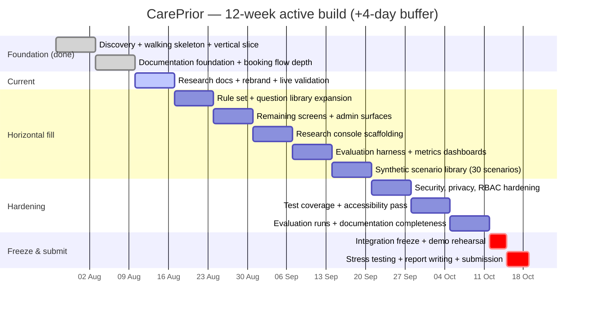

# Milestone Planner — CarePrior

**Subject:** 32040 Industry Project | UTS Master of IT | Spring 2026 | Solo developer: Zihad Burhan
**Nominal session length:** 14 weeks. **Active build window used for this planner:** 12 weeks, **27 Jul 2026 – 18 Oct 2026** (the 2-week gap between the nominal 14-week session and the 12-week build window is assumed to be a mid-session non-teaching break — flagged as an assumption to confirm against the real UTS calendar once available, consistent with [phase-1-discovery.md §8](phase-1-discovery.md)).
**Hard internal deadline:** everything feature-complete and demo-ready by **14 Oct 2026**. The final 4 days (**15–18 Oct**) are reserved *exclusively* for stress testing, bug fixing found under load, and report/documentation writing — no new features land in that window.
**Status as of 10 Aug 2026 (Week 3, today):** significantly ahead of the original plan — see §2.

---

## 1. How this maps onto the brief's phase model

[phase-1-discovery.md §7](phase-1-discovery.md) set the delivery order as **walking skeleton → vertical slice → horizontal fill → hardening**, deliberately reordered ahead of the brief's own Phase 2–12 documentation sequence at the stakeholder's direction (discovery doc §10). This planner is the concrete week-by-week schedule for that sequencing, folding the brief's 12 phases in around the engineering order rather than before it.

---

## 2. Weeks 1–3: what's already done (ahead of schedule)

| Week | Dates | Planned | Actual status |
|---|---|---|---|
| 1 | 27 Jul – 2 Aug | Phase 1 Discovery + scaffolding + walking skeleton | **Done.** Discovery doc completed 27 Jul; full walking skeleton *and* the brief's entire case-study vertical slice (6 backend services, 2 frontends, adaptive Q&A → rule trigger → AI interpretation → precedence → staff review → audit) built and logic-validated by 28 Jul — one day into the project. |
| 2 | 3 – 9 Aug | Phase 2 documentation foundation; booking flow depth | **Done.** Login bug fixed (`EmailStr` rejecting `.local` demo addresses); doctors/insurance/time-slot steps and mock scheduling added to the patient request flow; `hospital-website` public marketing app built as the third frontend. |
| 3 | 10 – 16 Aug (**today**) | — | **In progress, today's session:** literature review, tech-stack doc, AI-logic doc, this planner, and role-perspective doc written; demo hospital rebranded Willowbrook → **Hamilton's Hospital**; Docker Desktop brought up and the **full 10-container stack built and run live** (not just logic-tested) for the first time — login, consent, adaptive questioning, rule triggering, and the staff review queue were exercised end-to-end against real running containers and produced the correct `Immediate Human Review` outcome for the case-study scenario. |

This puts the project roughly **2–3 weeks ahead of a conservative pace** at the Week 3 checkpoint — the remaining plan below is intentionally generous with breadth work as a result, and Week 12/buffer stays fixed regardless of how far ahead earlier weeks run.

---

## 3. Weeks 4–11: horizontal fill and hardening

| Week | Dates | Milestone | Key deliverables | Brief phase(s) covered |
|---|---|---|---|---|
| 4 | 17–23 Aug | **Rule & question breadth** | Expand rule engine from 8 → ~20 prototype rules across more symptom categories; widen the adaptive question library beyond the cardiac cluster (respiratory, digestive, musculoskeletal, mental-health branches); rule-engine unit tests for every new rule | Phase 5 (business rules) |
| 5 | 24–30 Aug | **Remaining screens & admin surfaces** | Staff dashboard: analytics view, rule/model/prompt admin screens, user management; patient portal: request history/status polish | Phase 6 (UX/screens) |
| 6 | 31 Aug–6 Sep | **`research-console` scaffolding** | 4th frontend app; API surface for Static-form / Rule-only / AI-only / Hybrid evaluation modes (discovery doc §3, assumption 10) | Phase 10 (research evaluation) start |
| 7 | 7–13 Sep | **Evaluation harness** | Metrics computation (agreement with reference label, time-to-flag, override rate), comparison dashboards across the 4 modes | Phase 10 continued |
| 8 | 14–20 Sep | **Synthetic scenario library** | Author the full 30-scenario set — balanced across routine / ambiguous / contradictory / urgent per the risk-register checklist (discovery doc R-05); reference labels for each | Phase 9 (test data), Phase 10 |
| 9 | 21–27 Sep | **Security & privacy hardening** | Threat model write-up; JWT revocation/blacklisting; migrate single `role` column → full `Role`/`Permission`/`UserRole` tables; Alembic migrations replacing `create_all()` | Phase 7 (security), README §7 debt items |
| 10 | 28 Sep–4 Oct | **Test coverage & accessibility** | Backend unit/integration coverage across all 6 services; WCAG pass on all 3 (soon 4) frontends; fix anything colour-only in status chips | Phase 8 (testing) |
| 11 | 5–11 Oct | **Evaluation runs + doc completeness** | Run the 30-scenario library through all 4 modes; write up results; close out remaining Phase 2 documentation items (formal FR/NFR list, ERD, ADRs, threat model doc) | Phase 2 (completion), Phase 10 (completion) |

---

## 4. Week 12 + buffer: freeze, stress test, write

| Days | Dates | Focus | Explicitly NOT this window |
|---|---|---|---|
| Integration freeze | 12–14 Oct (3 days) | Full-stack bug bash against the live `docker compose` environment; demo script rehearsal (the exact walkthrough in README §5); final content/copy pass on `hospital-website`; freeze feature scope | New features, new rules, new screens |
| **Buffer — stress testing** | 15–16 Oct (2 days) | Concurrent-request load testing against the API layer; edge-case scenario replay (empty free text, all-missing-info, contradictory answers, AI-service-down failover path); fix anything the stress pass finds | Anything that isn't a defect found by testing |
| **Buffer — report & submission** | 17–18 Oct (2 days) | Final report assembly from `docs/` (this planner, tech-stack, ai-logic, literature review, discovery doc double as source material — not rewritten from scratch); proofread; package repo for submission | New engineering work of any kind |

**Why 18 Oct is the real ceiling, not 14 Oct:** the "ready" date (14 Oct) is a personal engineering deadline so the last four calendar days are genuinely free for verification and writing rather than last-minute feature work — a deliberate buffer against the single biggest risk already identified in the discovery doc (R-01, feasibility of a large solo build) and R-07 (documentation time overrun).

---

## 5. Milestone checklist (tick as completed)

- [x] **M1** — Discovery complete, architecture decided (27 Jul)
- [x] **M2** — Walking skeleton: all 9 deployable units talk to each other (28 Jul)
- [x] **M3** — Vertical slice: brief's case-study scenario works end-to-end (28 Jul)
- [x] **M4** — Booking flow depth: doctors/insurance/time + mock scheduling (early Aug)
- [x] **M5** — Third frontend (`hospital-website`) live, rebranded to Hamilton's Hospital (10 Aug)
- [x] **M6** — Full stack validated live under real Docker (not just logic-tested) (10 Aug)
- [ ] **M7** — Rule/question breadth complete (Week 4)
- [ ] **M8** — All planned screens/admin surfaces complete (Week 5)
- [ ] **M9** — `research-console` + evaluation harness live (Weeks 6–7)
- [ ] **M10** — 30-scenario synthetic library authored (Week 8)
- [ ] **M11** — Security/privacy hardening complete (Week 9)
- [ ] **M12** — Test coverage + accessibility pass complete (Week 10)
- [ ] **M13** — Evaluation runs complete, all documentation closed out (Week 11)
- [ ] **M14** — Feature freeze, demo rehearsed (14 Oct)
- [ ] **M15** — Stress testing complete, no open defects (16 Oct)
- [ ] **M16** — Final report submitted (18 Oct)

---

## 6. Risk carried into this plan

Directly inherited from [phase-1-discovery.md §5](phase-1-discovery.md): R-01 (feasibility of scope) is the dominant risk, mitigated by the fact that Weeks 1–3 are already complete ahead of schedule, giving Weeks 4–11 real slack. R-07 (documentation time overrun) is mitigated by writing documentation incrementally per week (as reflected in the table above) rather than as a Week 11 crunch. If any horizontal-fill week (4–8) overruns, the first things to cut are scenario-library breadth (30 → fewer, still balanced) and `research-console` polish — never the security/testing weeks (9–10) or the buffer (15–18 Oct), consistent with "breadth is the lever, not the core loop or the deadline."
