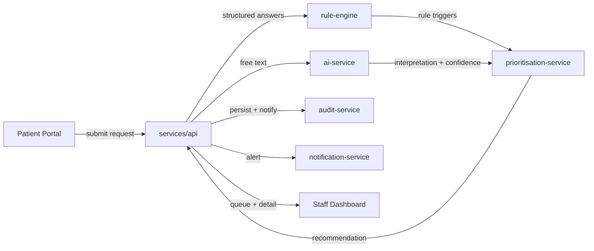

# Phase 1: Discovery — CarePrior

**Subject:** 32040 Industry Project | **Session:** Spring 2026 | **Institution:** UTS | **Program:** Master of IT
**Academic project title:** Design and Evaluation of an Explainable, Human-Supervised AI Clinical Intake and Prioritisation Platform for Primary Healthcare
**Working product name:** CarePrior
**Status:** Discovery complete — pending approval to enter Phase 2 (Documentation Foundation)

---

## 1. Purpose recap

CarePrior is a human-supervised clinical decision-support **prototype** that helps primary-care staff triage incoming appointment requests. It combines adaptive questioning, an AI interpretation layer, and a deterministic safety-rule engine to produce a prioritisation *recommendation* — never a diagnosis, treatment plan, or autonomous decision. All outputs require human review. All data is synthetic. This document is the Phase 1 deliverable defined by the project brief: assumptions, architecture plan, folder plan, risks, and scope decisions, with no major code written yet.

---

## 2. Decisions confirmed with stakeholder (2026-07-27)

| Decision | Choice | Implication |
|---|---|---|
| Architecture footprint | **Full split**: 3 frontend apps + 6 backend services, as specified in the brief's repo structure | This is a distributed system, not a monolith. Treated as the single biggest feasibility risk for a solo semester build (see §5, R-01). Mitigated through strict delivery sequencing (§7), not through cutting the topology. |
| AI provider | **Mock provider only**, selected by default via the provider interface | Zero API cost, fully deterministic (important for the research-evaluation module's repeatability requirements). Real Anthropic adapter is still built to the same interface, just not wired to a live key. Can be switched on later via `.env` with no domain-logic changes. |
| Timeline anchoring | **Generic Week 1–12 labels**, not tied to real UTS calendar dates yet | Schedule in the PM plan (Phase 2) will use relative week numbers. Can be re-anchored once real session dates are supplied — flagged as an open item in §8. |

---

## 3. Assumptions

1. Solo developer (Zihad Burhan), AI-assisted, no other engineering resources.
2. No access to real healthcare stakeholders, clinicians, or real patient data — all scenarios and reference outcomes are synthetic and self-authored against the rule/AI design, not clinically sourced.
3. Target runtime is local Docker Compose for development and demonstration; no cloud deployment is required for assessment.
4. Grading/demonstration environment has Docker, Node.js, and Python available; no assumption of GPU or paid infra.
5. "Full split" architecture (§2) means services are physically separate deployable units with their own FastAPI app and dependency set, but for local dev they run together via one `docker-compose.yml` and share one PostgreSQL instance (schema-per-module ownership, not separate databases) — separate databases per service is explicitly out of scope as unnecessary operational overhead for a prototype with no real scaling requirement.
6. Authentication is centralised: `services/api` issues JWTs; other services verify the same JWT (shared signing secret via env var) rather than each service running its own login — avoids duplicating identity logic six times.
7. "Do not integrate with real emergency dispatch systems" (brief §7 Module 7) is taken literally — the escalation workflow ends at an in-app staff alert, never an external call.
8. Where the brief lists a very large artifact count (e.g. 40–60 FRs, 40+ screens, 30+ synthetic scenarios), these are **target ceilings** for the finished capstone, not a Phase-1 deliverable — they get built incrementally across phases 2–12, not all at once.
9. Conference-paper and PhD-extension material (brief §45–46) is treated as end-of-project academic writing, produced in Phase 12, not something that constrains earlier engineering decisions.
10. "Research Evaluator" role and the four-mode comparison (Static Form / Rule-Only / AI-Only / Hybrid) is a first-class product feature, not just an internal test harness — it gets its own app (`research-console`) and API surface per the brief.
11. No real secrets, API keys, or credentials will be committed; `.env.example` will document required variables with placeholder values only.

---

## 4. Architecture plan

### 4.1 Style

Distributed, modular architecture. Each backend service is internally layered (Presentation/API → Application → Domain → Infrastructure) per brief §30, and services communicate synchronously over internal REST — no message bus/queue for the prototype (Redis/queues stay optional/deferred, per brief §28's "Optional" framing). This keeps the distributed-systems surface area (retries, eventual consistency, dead-letter handling) out of scope, which is the right trade-off given the topology decision already taken on in §2.

### 4.2 Frontend apps

| App | Responsibility | Consumes |
|---|---|---|
| `apps/patient-portal` | Registration, consent, appointment request creation, symptom entry, adaptive Q&A, submission review, status tracking | `services/api` |
| `apps/staff-dashboard` | Reception/nurse/manager/admin surfaces: review queue, request detail, explanation & rule-trigger panels, override/escalation, analytics, audit explorer, user/rule/model/prompt admin | `services/api` |
| `apps/research-console` | Synthetic scenario library, evaluation runs across the 4 modes, metrics dashboards, export | `services/api` (evaluation endpoints) |

All three are Next.js/TypeScript/Tailwind apps sharing `packages/ui`, `packages/shared-types`, `packages/validation`, `packages/config`, `packages/eslint-config` so the design system (Deep Teal palette, typography scale, status chip components) and Zod schemas stay consistent instead of triplicated.

### 4.3 Backend services

| Service | Responsibility | Owns (DB tables) |
|---|---|---|
| `services/api` | Auth/RBAC, patients, consent, appointment requests, adaptive questioning orchestration, staff review/escalation endpoints, reporting, evaluation orchestration. Acts as the **BFF/orchestrator** the frontends actually talk to. | Users, Roles, Permissions, Patients, ConsentRecords, AppointmentRequests, SymptomSubmissions, FollowUpQuestions, QuestionResponses, StaffReviews, OverrideDecisions, Escalations, Appointments, SyntheticScenarios, EvaluationRuns |
| `services/ai-service` | Provider-abstracted AI interpretation only (extraction, confidence, uncertainty). Called by `api`, never called directly by a frontend. | AIModelVersions, PromptVersions, AIInterpretations |
| `services/rule-engine` | Deterministic safety-rule evaluation against structured input. Versioned, admin-immutable rule set. | SafetyRules, SafetyRuleVersions, RuleConditions, RuleTriggers |
| `services/prioritisation-service` | Combines rule-engine output + AI interpretation + missing-info/contradiction checks into a recommendation, enforcing the precedence model (deterministic rules always outrank AI). | PrioritisationRecommendations, RecommendationFactors, UncertaintyAssessments |
| `services/audit-service` | Append-only audit event sink. Every other service calls this to record events; nothing else may write audit rows. | AuditEvents (insert-only, no update/delete route exists) |
| `services/notification-service` | In-app staff alerts for escalations/overdue queue items. No external dispatch. | Notifications |

`services/api` is the only service the frontends call directly; it fans out server-side to the other five. This keeps CORS/auth surface small (one public edge) while still giving each backend module its own deployable boundary, matching "full split" as chosen.

### 4.4 Cross-cutting additions (not explicit in the brief's tree, needed to make "full split" work)

- `services/shared/` — a small internal Python package (JWT verification, common Pydantic base schemas, an audit-client HTTP wrapper, structured logging config) vendored into each service's image. Without this, JWT validation and audit-event emission would be copy-pasted six times, which is the kind of premature-abstraction-avoidance judgement call the brief leaves to us — here the duplication cost is real and immediate, so a shared lib is justified, not speculative.
- Single shared PostgreSQL instance for local/dev (per assumption 5), each service's Alembic migrations scoped to only its own tables.

### 4.5 Data flow for the pipeline (brief §16)



---

## 5. Key risks (top items — full register in Phase 2)

| ID | Risk | Likelihood | Impact | Mitigation |
|---|---|---|---|---|
| R-01 | **Feasibility**: 3 apps + 6 services is a large surface for one solo semester build | High | High | Strict walking-skeleton-first sequencing (§7); every service gets a thin, real (not stubbed) implementation before any service goes deep; defer breadth (screen count, scenario count) before ever cutting the topology already agreed with the stakeholder. |
| R-02 | Accidental clinical claims in copy/UI | Medium | High | Disclaimer components reused everywhere (brief §38); no diagnosis/treatment language in prompts or templates; reviewed at end of each phase. |
| R-03 | AI produces invalid/unparseable structured output | Medium | Medium | Strict JSON-schema validation in `ai-service`; malformed output routes to Manual Review Required, never silently retried into a clinical path. |
| R-04 | Deterministic rules accidentally overridden by AI-only signal | Low | High | Precedence enforced inside `prioritisation-service` domain logic with a dedicated test suite (brief §33 item 7). |
| R-05 | Synthetic scenario/reference-label bias skews evaluation metrics | Medium | Medium | Scenario authoring checklist requires balanced categories (routine/ambiguous/contradictory/urgent) before Phase 10. |
| R-06 | Auth/session logic duplicated inconsistently across 6 services | Medium | Medium | Shared verification lib (§4.4) instead of per-service reimplementation. |
| R-07 | Time overrun on documentation breadth (40 doc deliverables, §35) | High | Medium | Documentation generated incrementally per phase, not as one late push; academic-writing-only items (paper outline, PhD extension) deferred to Phase 12. |

---

## 6. File & folder plan

Matches the brief's §29 structure, with the `services/shared` addition from §4.4 called out. Created in Phase 3 (Scaffolding) — not created yet in this discovery phase.

```
careprior/
├── apps/
│   ├── patient-portal/
│   ├── staff-dashboard/
│   └── research-console/
├── services/
│   ├── api/
│   ├── ai-service/
│   ├── rule-engine/
│   ├── prioritisation-service/
│   ├── audit-service/
│   ├── notification-service/
│   └── shared/              # NEW — JWT verification, base schemas, audit client, logging config
├── packages/
│   ├── ui/
│   ├── shared-types/
│   ├── validation/
│   ├── config/
│   └── eslint-config/
├── database/
│   ├── migrations/
│   ├── schema/
│   └── seeds/
├── docs/
│   ├── business-analysis/
│   ├── requirements/
│   ├── use-cases/
│   ├── process-models/
│   ├── architecture/
│   ├── data/
│   ├── api/
│   ├── ux/
│   ├── security/
│   ├── privacy/
│   ├── testing/
│   ├── evaluation/
│   └── project-management/   # this file lives here
├── evaluation/
│   ├── scenarios/
│   ├── reference-labels/
│   ├── experiments/
│   └── results/
├── infrastructure/
│   ├── docker/
│   └── github-actions/
├── scripts/
├── .env.example
├── docker-compose.yml
├── README.md
├── CONTRIBUTING.md
├── SECURITY.md
├── LICENSE
└── CHANGELOG.md
```

---

## 7. Delivery sequencing (how R-01 gets managed)

Because the full-split topology was chosen, breadth is the lever we pull under time pressure, not architecture. Recommended order, mapped loosely onto brief §36/§39's phases:

1. **Walking skeleton** — all 9 deployable units (3 apps + 6 services) exist, containerised, health-checked, and can talk to each other through one authenticated round trip. No real domain logic yet.
2. **Vertical slice** — the exact brief §7 case-study scenario (vague symptom → adaptive questions → chest-pain disclosure → immediate-review rule trigger → staff review → audit) working end-to-end through every service, with everything else stubbed.
3. **Horizontal fill** — breadth: remaining screens, remaining FRs, full rule set, full scenario library, analytics, research-evaluation modes — added on top of a topology that already works.
4. **Hardening** — testing, security, accessibility, docs completeness pass (brief §33, §17, §27).

This means Phase 2 documentation should be written against the *target* full scope (since it's an academic deliverable and needs to describe the complete design), while implementation visibly tracks steps 1–4 above, with phase-end summaries reporting honestly which step we're on.

---

## 8. Open items to revisit later (not blocking)

- Real UTS 32040 Spring 2026 session dates, to re-anchor the Week 1–12 schedule once available.
- Whether a real Anthropic API key will be added later for a live demo (currently mock-only).
- Confirm supervisor-facing deliverable format expectations (e.g. is a written report submitted separately from this repo, or does `docs/` constitute the report).

---

## 9. Next step

This completes Phase 1. Per the brief's process (§39), the next step is approval to proceed to **Phase 2: Documentation Foundation** — README, project charter, scope, stakeholders, requirements, use cases, ADRs, ERD, API outline, security model, testing strategy — still no application code.

## 10. Build outcome (2026-07-28) — superseded by direct build request

The stakeholder asked to skip ahead of the phase gate and have a testable local build immediately. Rather than
continuing to gate on documentation, a full vertical slice of the target architecture from §4 was built directly:
all 6 backend services, both `patient-portal` and `staff-dashboard` frontends, the shared Python library, and the
Docker Compose environment — implementing the exact brief §7 case-study scenario end-to-end (adaptive
questioning → deterministic rule trigger → AI interpretation → precedence-combined recommendation → staff
review/override → append-only audit).

**Validation performed without Docker/Node/modern Python available in the build sandbox**: portable Node 20 and
Python 3.12 toolchains were downloaded to a scratch directory (not installed system-wide) to run real builds and
logic tests rather than only static review. Both frontends `next build` cleanly; all 6 backend services
import-check cleanly against their pinned dependencies (this caught a missing `email-validator` dependency and a
Pydantic warning, both fixed); every SQLAlchemy model compiles to valid PostgreSQL DDL; the rule engine, mock AI
provider, prioritisation precedence logic, JWT auth, password hashing, and adaptive-question branching were each
directly unit-tested and pass, including the specific assertion that a low-confidence or failed AI signal can
never downgrade a higher-severity deterministic rule outcome. Full details in `README.md` §6.

**Not exercised**: an actual `docker compose up` with live inter-container networking, and the browser UI. The
user has Docker available locally and will run this themselves — see `README.md` §5 for the run instructions and
demo script.

This step reorders the brief's phase sequence (implementation before the full documentation-foundation phase)
at the stakeholder's explicit direction; the documentation deliverables from Phase 2 (formal FRs/NFRs, use
cases, ERD, threat model, etc.) remain outstanding and should be produced next, now describing a system that
demonstrably runs rather than one that is only planned.
