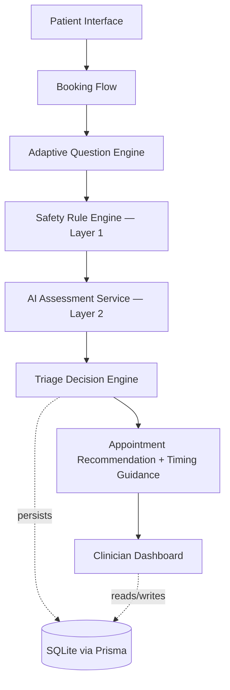
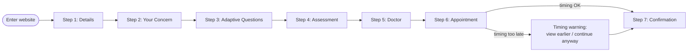
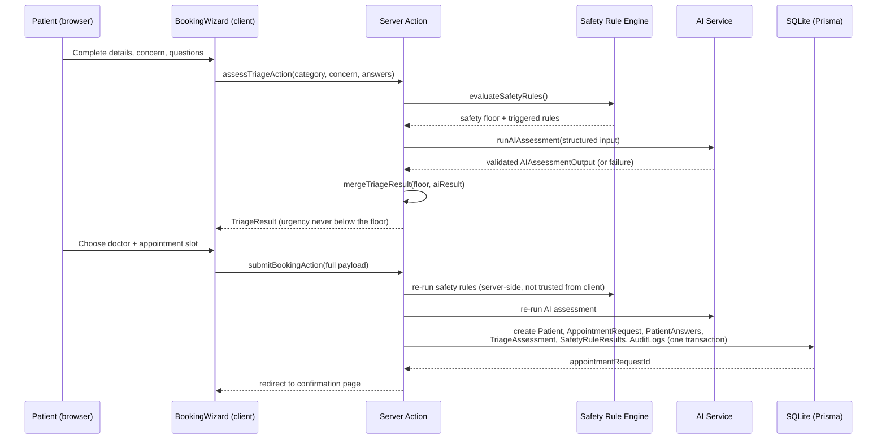
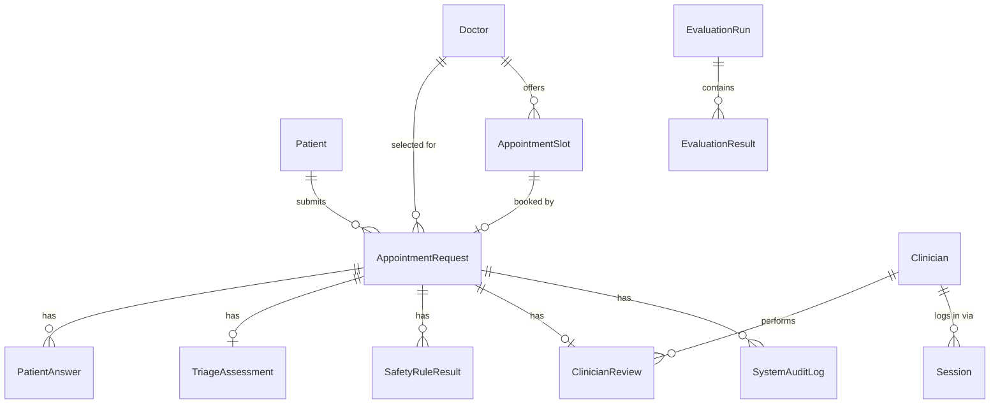

# Architecture

## System architecture



The Safety Rule Engine always executes before the AI Assessment Service, and the Triage
Decision Engine can never let the AI lower a result the safety rules already set.

## Patient workflow



## Sequence diagram — submitting a request



Note: triage is deliberately **recomputed server-side at submission time** rather than trusting a
client-supplied result, so a tampered client cannot force a lower urgency into the database.

## Database ER diagram (simplified)



`Question` and `SafetyRuleDefinition` are intentionally **not** database tables — they're
versioned, typed configuration data (`src/data/questions.ts`, `src/data/safetyRules.ts`) read by
the engines at request time. `PatientAnswer` stores a snapshot of the question text at the time
it was asked, so historical answers remain interpretable even if the question bank changes later.

## Directory structure

```
src/
  app/
    (site)/              patient-facing routes — home, services, doctors, about, contact, book/, request/[id]/confirmation/
    clinician/            staff routes — login, dashboard, requests/[id], evaluation
  components/
    patient/              booking-flow UI (StepIndicator, DetailsForm, ConcernForm, QuestionFlow, AssessmentResult, DoctorPicker, AppointmentPicker)
    clinician/             dashboard UI (AppShell, ReviewForm, EvaluationDashboard, LoginForm)
    triage/                shared safety/urgency display (SafetyBanner)
    common/                Button, Card, Header, Footer, UrgencyBadge, Disclaimer, DoctorAvatar, ContactForm
  lib/
    ai/                    provider interface, mock provider, Claude provider, output schema, aiService factory
    triage/                decision engine, urgency/timeframe mappings, appointment-timing guidance, doctor matching
    safety/                deterministic rule evaluator
    questions/              adaptive question-selection engine
    validation/             Zod schemas for every server action boundary
    database/               Prisma client, request/doctor/audit data access
    auth/                   password hashing, cookie session management
    evaluation/             scenario runner, metrics, confusion matrix
  data/                    doctors, questions, safetyRules, scenarios, categories, insurance (all typed config, not hardcoded in components)
  types/                   central shared TypeScript types
prisma/                    schema.prisma, migrations/, seed.ts
tests/                     Vitest suite
```

## Why this stack (not the earlier microservices build)

An earlier pass at this project (preserved in `_archive/careprior-v1/`) used 6 separate FastAPI
services, 3 separate Next.js frontends, PostgreSQL, and Docker Compose. For a solo-developer,
12-week academic prototype that needs to be demonstrated and explained in a report, that
architecture added real cost — Docker as a hard dependency to even run it, cross-service network
calls to reason about, and far more moving parts than the assessed functionality needs — without
adding assessable value. This build consolidates everything into one Next.js app with SQLite, per
the project brief's explicit stack recommendation, while carrying forward the same core ideas
(deterministic safety floor, mandatory human review, full audit trail, swappable AI provider).
